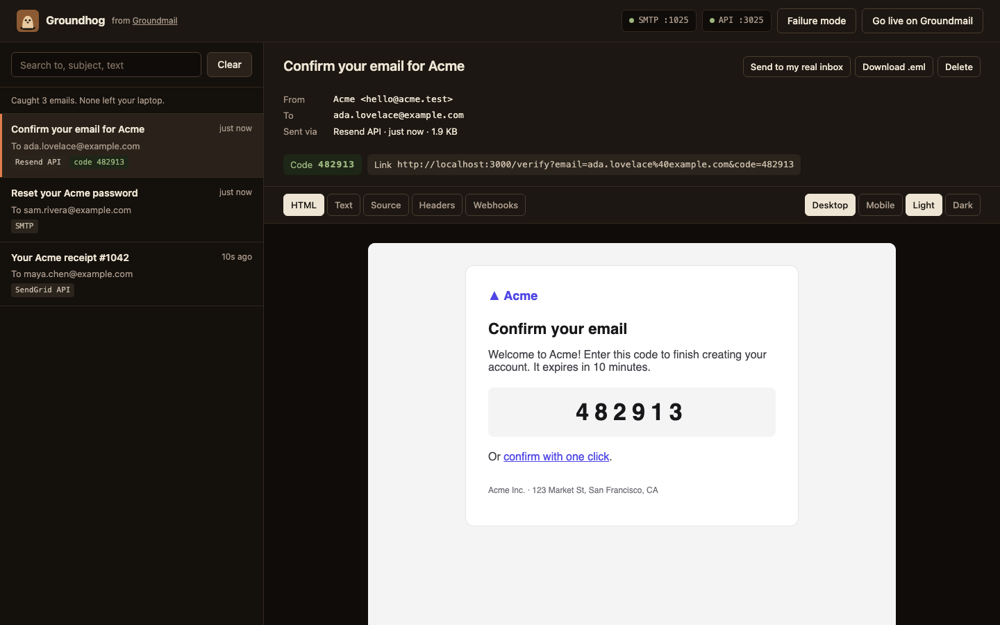
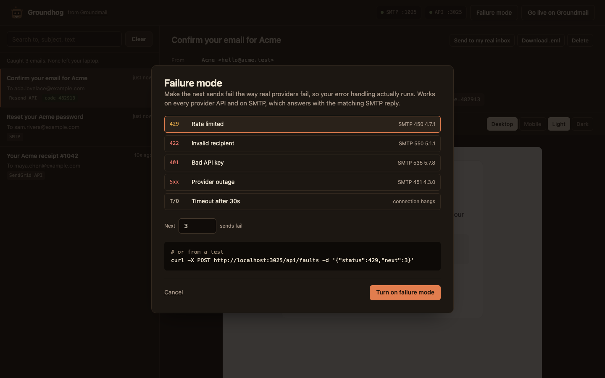

<p align="center"></p>

<h1 align="center">Groundhog</h1>

<p align="center">Catch every email your app sends while you build. Nothing leaves your laptop.<br>
An open-source local inbox from <a href="https://groundmail.dev/?utm_source=github&utm_medium=readme&utm_campaign=groundhog&utm_content=header">Groundmail</a>.</p>

---

Groundhog is a local email inbox for development and tests. Point your app at it and every
email it sends shows up at `http://localhost:3025`: sign-up codes, password resets, receipts.

- **SMTP** on port 1025, and the **HTTP send APIs** of Groundmail, SendGrid, Postmark, Mailgun,
  Resend and Amazon SES. Each provider's official SDK works unmodified: you change its base URL,
  not your code.
- **A web inbox** with live updates, HTML/text/source/headers, attachments, desktop and mobile
  widths, light and dark preview, and the one-time code and links pulled out for you.
- **Failure mode**: make the next sends fail with a 429, 422, 401, outage or timeout, in each
  provider's own error format (SMTP answers with the matching reply code).
- **Webhook simulation**: fire delivered, bounce, complaint, open and click events at your app in
  the payload and signature format of the provider the email came through.
- **Send to my real inbox**: see a caught email in real Gmail or Outlook, through a free Groundmail account.
- **For tests and agents**: `waitForEmail()` for Playwright/Vitest, and an MCP server so coding
  agents can read the verification email themselves.

<p align="center"></p>

<p align="center"><a href="docs/demo.gif">Watch a 15-second demo</a></p>

Coming from MailHog? Groundhog keeps SMTP on 1025; the inbox moves from 8025 to 3025.

## Start it

```bash
npx @groundmail/groundhog
```

Node 20 or newer. It opens the inbox in your browser. Or with Docker:

```bash
docker run --rm -p 1025:1025 -p 3025:3025 ghcr.io/groundmail/groundhog
```

```yaml
# docker-compose.yml, next to your app
services:
  groundhog:
    image: ghcr.io/groundmail/groundhog
    ports: ["1025:1025", "3025:3025"]
```

In Compose, other services reach it at `groundhog:1025` (SMTP) and `http://groundhog:3025` (APIs).
Images are multi-arch (amd64, arm64).

## Point your app at it

Pick the way your app already sends. Any API key, username or password is accepted.

### SMTP (Nodemailer, Laravel, Rails, Django, Phoenix…)

```bash
SMTP_HOST=localhost
SMTP_PORT=1025
```

```js
// Nodemailer
nodemailer.createTransport({ host: 'localhost', port: 1025 })
```

```ini
# Laravel .env
MAIL_MAILER=smtp
MAIL_HOST=127.0.0.1
MAIL_PORT=1025
MAIL_ENCRYPTION=null
```

```ruby
# Rails: config/environments/development.rb
config.action_mailer.delivery_method = :smtp
config.action_mailer.smtp_settings = { address: "localhost", port: 1025 }
```

```python
# Django settings.py
EMAIL_HOST = "localhost"
EMAIL_PORT = 1025
```

### Groundmail

```js
import { Groundmail } from 'groundmail'

const gm = new Groundmail(process.env.GROUNDMAIL_API_KEY ?? 'gm_test_anything', {
  baseUrl: process.env.GROUNDMAIL_BASE_URL ?? 'http://localhost:3025',
})
```

### SendGrid

```js
import sgMail from '@sendgrid/mail'

sgMail.setApiKey('SG.anything')
sgMail.client.setDefaultRequest('baseUrl', 'http://localhost:3025/sendgrid')
```

### Postmark

```js
import { ServerClient } from 'postmark'

const client = new ServerClient('anything', { requestHost: 'localhost:3025/postmark', useHttps: false })
```

### Mailgun

```js
import Mailgun from 'mailgun.js'
import FormData from 'form-data'

const mg = new Mailgun(FormData).client({ username: 'api', key: 'anything', url: 'http://localhost:3025/mailgun' })
```

### Resend

```bash
RESEND_BASE_URL=http://localhost:3025/resend
```

### Amazon SES

```js
import { SESv2Client } from '@aws-sdk/client-sesv2' // the v1 SESClient works too

const ses = new SESv2Client({
  endpoint: 'http://localhost:3025/ses',
  region: 'us-east-1',
  credentials: { accessKeyId: 'x', secretAccessKey: 'x' },
})
```

| API | Base URL | Emulated endpoints |
|---|---|---|
| Groundmail | `http://localhost:3025` (or `/groundmail`) | `POST /emails`, `POST /emails/batch`, `GET /emails/:id` |
| SendGrid | `http://localhost:3025/sendgrid` | `POST /v3/mail/send` |
| Postmark | `localhost:3025/postmark` | `POST /email`, `/email/batch`, `/email/withTemplate`, `/email/batchWithTemplates` |
| Mailgun | `http://localhost:3025/mailgun` | `POST /v3/:domain/messages`, `/v3/:domain/messages.mime` |
| Resend | `http://localhost:3025/resend` | `POST /emails`, `POST /emails/batch`, `GET /emails/:id` |
| Amazon SES | `http://localhost:3025/ses` | v2 `SendEmail` (simple, raw, template), v1 `SendEmail`, `SendRawEmail` |

Stored provider templates (a SendGrid `template_id`, a Postmark `TemplateAlias`…) can't be
rendered locally; Groundhog shows the template name and the data it was sent with.

## Testing

`waitForEmail()` waits for an email (one that's already arrived counts) and gives you its code and links.

```bash
npm install -D @groundmail/groundhog
```

```ts
// Playwright
import { expect, test } from '@playwright/test'
import { waitForEmail } from '@groundmail/groundhog'

test('magic-link sign-in', async ({ page }) => {
  const to = `ada+${Date.now()}@example.com`
  await page.goto('http://localhost:3000/signin')
  await page.getByLabel('Email').fill(to)
  await page.getByRole('button', { name: 'Email me a link' }).click()

  const email = await waitForEmail({ to })
  email.code     // "482913"
  email.links[0] // "http://localhost:3000/magic?token=…"

  await page.goto(email.links[0])
  await expect(page.getByRole('heading', { name: `Signed in as ${to}` })).toBeVisible()
})
```

The full runnable version is in [examples/playwright](examples/playwright). Helpers:

| Helper | What it does |
|---|---|
| `waitForEmail({ to, subject, since, timeout })` | Resolves with the first matching email; throws after `timeout` (default 30 s) |
| `listEmails({ to, subject, q, limit })` | Newest first |
| `getEmail(id)`, `clearEmails()` | |
| `extractCode(email)`, `extractLinks(email)`, `extractLink(email, contains?)` | Work on any HTML or text too |
| `simulateFault({ status, next })`, `clearFaults()` | Failure mode from a test |
| `fireWebhook({ id, event })` | Fire a simulated webhook |
| `startGroundhog({ httpPort, smtpPort })` | Run Groundhog inside your test process (`httpPort: 0` picks a free port) |

The helpers use `GROUNDHOG_URL` (default `http://localhost:3025`) or a `baseUrl` option.

Prefer plain HTTP? The same things are on the JSON API:

| Request | |
|---|---|
| `GET /api/emails?to=&subject=&q=&limit=` | List (newest first) |
| `GET /api/emails/latest?to=` | Latest match, or 404 |
| `GET /api/wait?to=&subject=&timeout=30000` | Long-poll until a match arrives (408 on timeout) |
| `GET /api/emails/:id` | One email, with `code` and `links` |
| `GET /api/emails/:id/source` | Raw RFC 5322 source (`?download` for an `.eml`) |
| `GET /api/emails/:id/attachments/:n` | An attachment |
| `DELETE /api/emails/:id`, `DELETE /api/emails` | Delete one, or clear the inbox |
| `POST /api/faults` `{ "status": 429, "next": 3 }` | Failure mode; `DELETE /api/faults` turns it off |
| `PUT /api/webhooks` `{ "url": "…" }` | Where simulated webhooks go |
| `POST /api/emails/:id/webhooks` `{ "event": "bounced" }` | Fire one |
| `GET /api/events` | Server-sent events for everything above |

## Failure mode

Most apps have never seen their own error handling run. Turn on failure mode in the inbox
(**Failure mode** in the header) or from a test, and the next sends fail the way the real
provider fails:

```bash
curl -X POST localhost:3025/api/faults -d '{"status":429,"next":3}'
```

| `status` | HTTP APIs answer | SMTP answers |
|---|---|---|
| `429` | the provider's rate-limit error (SES v1: `Throttling`) | `450 4.7.1` |
| `422` | the provider's invalid-recipient error (400 where the provider uses 400) | `550 5.1.1` at `RCPT TO` |
| `401` | the provider's bad-key error (403 where the provider uses 403) | `535 5.7.8` |
| `5xx` | 500/503 in the provider's format | `451 4.3.0` |
| `timeout` | holds the request 30 s, then drops the connection | holds, then `421` |

A banner stays in the inbox while failure mode is on. `next: 0` or `DELETE /api/faults` turns it off.

<p align="center"></p>

## Webhook simulation

Set your app's webhook URL in an email's **Webhooks** tab (or `PUT /api/webhooks`), then fire
`delivered`, `bounced`, `complained`, `opened` or `clicked`. The payload is in the format of the
API the email came through (Groundmail's for SMTP), or pick one. The delivery log shows what
your app answered.

Signatures use fixed local keys, so your verification code runs unchanged in development:

| Format | Signature | Local key |
|---|---|---|
| Groundmail | `Groundmail-Signature: t=…,v1=…` | `whsec_groundhog_local_dev_secret` |
| Resend (Svix) | `svix-id`, `svix-timestamp`, `svix-signature` | `whsec_Z3JvdW5kaG9nLWxvY2FsLWRldi13ZWJob29rLWtleSE=` |
| SendGrid | `X-Twilio-Email-Event-Webhook-Signature` (ECDSA) | public key shown in the Webhooks tab and `GET /api/webhooks` |
| Mailgun | `signature.signature` in the body | `groundhog-local-mailgun-signing-key` |
| Postmark | not signed (Postmark uses basic auth) | |
| Amazon SES | SNS `Notification` envelope | AWS signs SNS with its own certificate, which can't be reproduced locally; skip SNS signature checks in development |

Override the keys with `PUT /api/webhooks { "secrets": { "groundmail": "…" } }`. These keys are
public; never use them outside local development.

## Send to my real inbox

Some things only show up in a real mail client. Open an email, click **Send to my real inbox**,
and connect a free [Groundmail account](https://app.groundmail.dev/signup?utm_source=github&utm_medium=readme&utm_campaign=groundhog&utm_content=real_inbox)
once. The sign-in opens in your browser; there's no key to paste. Copies come from Groundmail's
sandbox sender, which only delivers to your own account address until you verify a domain, so
Groundhog can't email real users by mistake. The sign-in is saved in `~/.config/groundhog` and
only used when you click send.

## AI coding agents (MCP)

Agents can finish sign-up and password-reset flows on their own by reading the email:

```bash
claude mcp add groundhog -- npx -y @groundmail/groundhog mcp
```

```json
// Cursor: .cursor/mcp.json
{ "mcpServers": { "groundhog": { "command": "npx", "args": ["-y", "@groundmail/groundhog", "mcp"] } } }
```

Tools: `list_emails`, `wait_for_email(to, timeout)`, `get_email(id)`, `get_code(to)`,
`get_link(to, contains)` and `simulate_fault(status, next)`. The MCP server uses the Groundhog
running at `GROUNDHOG_URL` (default `http://localhost:3025`), and starts one itself if none is running.

## Options

| Flag | Env | Default |
|---|---|---|
| `--smtp-port` | `GROUNDHOG_SMTP_PORT` | `1025` |
| `--http-port` | `GROUNDHOG_HTTP_PORT` | `3025` |
| `--host` | `GROUNDHOG_HOST` | `localhost` (`0.0.0.0` in Docker) |
| `--store <file>` | `GROUNDHOG_STORE` | in memory; a JSON file keeps emails across restarts |
| `--max <n>` | | `1000` emails |
| `--webhook-url <url>` | `GROUNDHOG_WEBHOOK_URL` | |
| `--no-open` | `GROUNDHOG_NO_OPEN=1` | opens the browser at a terminal |
| `--quiet` | | logs each caught email |

Groundhog never relays mail. Nothing it catches is sent anywhere unless you click
**Send to my real inbox**.

## Ready for real inboxes?

When it's time to ship, [Groundmail](https://groundmail.dev/?utm_source=github&utm_medium=readme&utm_campaign=groundhog&utm_content=go_live)
sends your app's email for real: an HTTP API and SMTP, with transactional mail on its own servers
and IPs. The free plan includes 3,000 emails a month. If you use the Groundmail SDK, going live is
two environment variables:

```bash
GROUNDMAIL_API_KEY=gm_live_…   # and drop GROUNDMAIL_BASE_URL
```

[Start free on Groundmail →](https://app.groundmail.dev/signup?utm_source=github&utm_medium=readme&utm_campaign=groundhog&utm_content=go_live)

## Development

```bash
npm install
npm run build
npm test                         # Vitest: every provider SDK, SMTP, faults, webhooks, MCP
npx playwright install chromium
npm run test:e2e                 # the inbox UI and the Playwright example
```

Releases are automatic: bump `version` in `package.json` and merge to `main`. The release
workflow publishes to npm (with provenance), tags the version, and pushes the Docker image.

Issues and pull requests are welcome; see [CONTRIBUTING.md](CONTRIBUTING.md). Report security issues as described in [SECURITY.md](SECURITY.md).

## License

[MIT](LICENSE)
